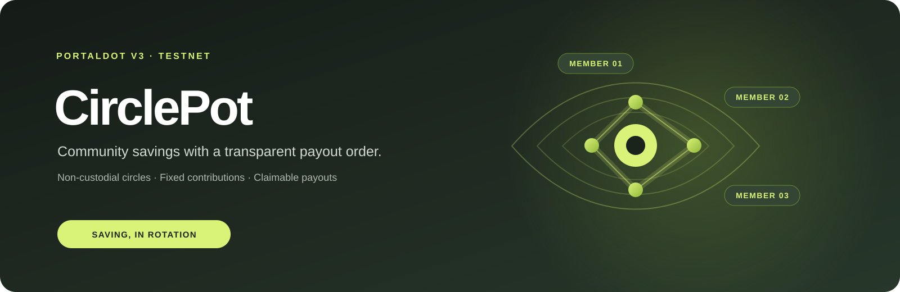

# CirclePot

<p align="center">
  
</p>

<p align="center">
  <strong>Transparent rotating savings circles, enforced by a smart contract.</strong><br />
  Organize a group, agree on fixed contributions and payout order, and follow every step on Portaldot V3.
</p>

<p align="center">
  <a href="https://scanner-testnet-v3.portaldot.dev"></a>
  
  
  <a href="https://github.com/sandman-sh/circlepot"></a>
</p>

**Source repository:** [github.com/sandman-sh/circlepot](https://github.com/sandman-sh/circlepot)

## Overview

CirclePot is a non-custodial rotating savings application, sometimes called a savings circle or ROSCA. Members contribute the same amount each round. When everyone has contributed, the smart contract credits the pooled amount to the next member in the agreed order. Each member receives one payout over the life of the circle.

CirclePot does **not** pay interest or generate yield. It helps a group access a larger amount of its own savings at different times. Testnet POT has no real-world value.

## How a circle works

1. A creator sets a name, contribution amount, seat count, refund window, and optionally reserves seats for specific wallet addresses.
2. The creator joins separately to take a seat. Joining order determines payout order.
3. People open the circle link, connect an EVM wallet, and join while seats are available. Joining does not require a deposit.
4. Once every seat is filled, each member contributes the exact agreed amount once per round.
5. When all members have contributed, the contract credits the full round pot to that round's scheduled member. The recipient withdraws with **Claim**.
6. The process repeats until every seat has received one payout and the circle completes.

If a partially funded round stalls beyond its configured refund window, anyone can trigger the refund. The contract credits each contributor their exact contribution; each person claims their own credit. While a circle is still filling, members can leave and the creator can cancel it. No contributions are accepted until the circle is full.

## Product features

- **Overview:** circle and payout metrics, wallet position, action center, payout forecast, and event-based POT charts.
- **Circles:** browse, search, filter, sort, and open circle details; see seats, round status, contribution progress, payout order, and recent history.
- **Create and invite:** choose 2–12 seats, set a fixed contribution and a 1–30 day refund window, reserve seats, and share a circle link or QR code.
- **Activity:** filter contract events, view transaction links, filter to your activity, and export the visible history to CSV.
- **Wallet and transactions:** connect an injected EVM wallet or optional WalletConnect, switch to Portaldot V3 Testnet, review gas estimates, approve writes in your wallet, and follow transaction status.
- **Contract setup:** deploy a CirclePot contract from the app or connect an existing deployment; the app checks bytecode and an ABI call before loading it.
- **Live state:** refresh contract data from Portaldot RPC, watch contract events when available, and poll as a fallback.

Circle data and transaction events are public on-chain. The app also stores address labels, event history, and interface preferences in browser local storage. App invite links provide navigation context; they do not create referral rewards or on-chain referral accounting.

## Contract design

The Solidity contract is the only component that holds POT.

- Contributions are accepted only after the circle is full and only for the exact configured amount.
- Joining order determines payout order. The creator must join to take a seat.
- Round payouts and refunds use a pull-payment model: the contract records a member's claimable balance, and that member withdraws it with `claimReturns()`.
- A recipient's wallet cannot block a completed round by reverting a transfer.
- A refund can be triggered by anyone after the configured timeout; credits belong to the original contributors.
- There is no owner withdrawal, fee, custodian, pause, or upgrade function in the contract.
- Each circle has 2–12 seats. Its refund window is set at creation from 1–30 days.

Read [SECURITY.md](SECURITY.md) for the contract's design properties and review checklist. These notes are not an independent security audit.

## Portaldot V3 Testnet

| Setting | Value |
| --- | --- |
| Network | Portaldot V3 Testnet |
| EVM chain ID | 420420777 (`0x190f1ca9`) |
| RPC | [test-evm-rpc-v3.portaldot.dev](https://test-evm-rpc-v3.portaldot.dev) |
| EVM native gas token | POT (18 decimals, wei units) |
| Explorer | [scanner-testnet-v3.portaldot.dev](https://scanner-testnet-v3.portaldot.dev) |

The app needs a browser EVM wallet and test POT at that wallet's EVM address to send transactions. EVM balances and transaction values use 18-decimal wei units; the Substrate-native wallet displays POT with 14 decimals. All writes require wallet approval. A native Portaldot address and an EVM address are distinct address formats; request test funds for the address and network you intend to use.

## Run locally

### Requirements

- Node.js 22.12 or newer
- npm
- An EVM wallet in the browser for testnet writes
- Portaldot V3 Testnet POT for gas

### Install and start

```powershell
git clone https://github.com/sandman-sh/circlepot.git
cd circlepot
npm install
npm run dev
```

Open the local URL printed by Vite. The home page can be explored without connecting a wallet. Select **Start a circle** to open the workspace. On first use, connect a wallet, switch it to Portaldot V3 Testnet, then deploy a contract or connect an existing CirclePot deployment.

To use an existing deployment in a shared URL, open:

```text
?app=1&contract=0xYourContractAddress
```

A circle invitation also includes the contract address and circle ID so the recipient can open that circle directly.

### Optional environment settings

Copy `.env.example` to `.env.local` and set only the values you use.

| Variable | Purpose |
| --- | --- |
| `VITE_CIRCLEPOT_ADDRESS` | Attach a CirclePot deployment on startup |
| `VITE_WALLETCONNECT_PROJECT_ID` | Enable WalletConnect in the wallet chooser |
| `VITE_SENTRY_DSN` | Enable Sentry browser error reporting |

## Build and checks

```sh
npm run compile:contract
npm run build
npm run lint
npm run test:unit
```

The contract-flow test uses a local JSON-RPC EVM at `http://127.0.0.1:8545` (or `CIRCLEPOT_TEST_RPC`).

Start a disposable local Ganache node in a separate terminal:

```sh
npx --yes ganache@7.9.2 --server.port 8545 --chain.chainId 420420777 --wallet.totalAccounts 5 --wallet.defaultBalance 10000 --wallet.mnemonic "test test test test test test test test test test test junk" --logging.quiet
```

Then run:

```sh
npm run test:contract
```

The local contract-flow test covers deployment, ordered payouts and claims, circle completion, stalled-round refunds, invite-only joins, leave/cancel rules, pagination, user-circle lookup, and a recipient that rejects native currency. It exercises a local simulated chain and does not send transactions to Portaldot. Use only the disposable test mnemonic with the local test node; never import it into a real wallet.

## Verify a testnet deployment

The read-only verifier checks that the configured address has bytecode and responds to the CirclePot ABI. Pass a deployment address and, optionally, its transaction hash:

```sh
npm run verify:testnet -- 0xYourContractAddress 0xDeploymentTransactionHash
```

For source verification in the explorer, compile with Solidity 0.8.38, optimizer 300 runs, `viaIR`, and EVM target `paris`, as configured in [scripts/compile-contract.mjs](scripts/compile-contract.mjs).

## Current verification scope

Local build, lint, utility tests, and simulated contract-flow tests can be run from this repository. A real Portaldot deployment, multi-wallet testnet cycle, and wallet-specific network-switch behavior require a connected browser wallet and testnet transactions. The refund timeout also requires the configured period to elapse on-chain unless tested on a local chain with controllable time.

## Project structure

- `contracts/CirclePot.sol` — savings-circle contract and on-chain rules.
- `src/App.tsx` — app shell, wallet/network flow, deployment, and contract transactions.
- `src/Dashboard.tsx` — dashboard views, charts, circle details, activity, and dialogs.
- `src/lib/web3.ts` — Portaldot chain configuration, Wagmi connectors, RPC transport, and explorer links.
- `src/lib/utils.ts` — shared types, formatting, validation, and utilities.
- `src/generated/circlePotArtifact.ts` — compiled ABI and bytecode used by the app.
- `scripts/compile-contract.mjs` — Solidity compilation and artifact generation.
- `scripts/test-contract.mjs` — local simulated-chain contract-flow test.
- `scripts/verify-testnet.mjs` — read-only testnet deployment verifier.
- `SECURITY.md` — security properties and pre-mainnet review items.

